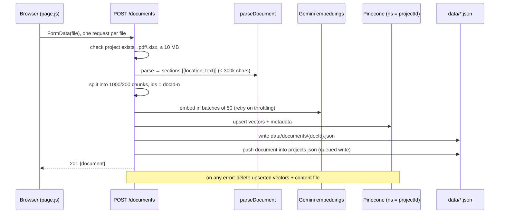
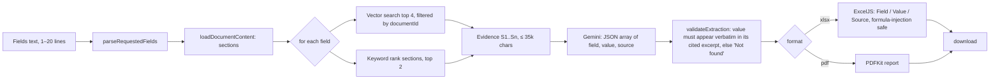

# Sourcework — Architecture, Data Model & Workflows

Sourcework is a single-page document workspace: you group PDF/Excel files into **projects**, ask questions answered only from those files (RAG with citations), and export chosen fields from a document to Excel or PDF.

## 1. Stack

| Layer | Technology | Where |
|---|---|---|
| UI | Next.js 14 App Router, React 18 client component, Tailwind/CSS, `react-icons`, `react-markdown` | `app/page.js`, `app/globals.css` |
| API | Next.js Route Handlers (Node runtime) | `app/api/**/route.js` |
| Parsing | LangChain `PDFLoader` (pdf-parse) for PDF, ExcelJS for `.xlsx` | `lib/documentContent.js` |
| Chunking | LangChain `RecursiveCharacterTextSplitter` (1000 chars, 200 overlap) | `documents/route.js` |
| Embeddings | Google `gemini-embedding-2` via a batched, rate-limit-retrying subclass | `lib/geminiEmbeddings.js` |
| LLM | `gemini-3.6-flash` via the Gemini **Interactions** API, wrapped as a LangChain chat model | `lib/geminiInteractions.js` |
| Vector DB | Pinecone (one index, **one namespace per project**) via `@langchain/pinecone` | `lib/vectorStore.js` |
| Metadata DB | JSON file `data/projects.json` with an in-process write queue | `lib/projects.js` |
| Parsed text cache | One JSON file per document in `data/documents/` | `lib/documentContent.js` |
| Export | ExcelJS (xlsx), PDFKit (pdf) | `lib/exportData.js` |

There is no SQL database. "The database" is three stores: **`projects.json`** (metadata), **`data/documents/*.json`** (parsed text), and **Pinecone** (vectors).

## 2. Data model (ER diagram)

```mermaid
erDiagram
    PROJECT ||--o{ DOCUMENT : "documents[] (embedded)"
    PROJECT ||--|| PINECONE_NAMESPACE : "namespace = project.id"
    DOCUMENT ||--|| DOCUMENT_CONTENT : "data/documents/{id}.json"
    DOCUMENT_CONTENT ||--|{ SECTION : "array of"
    DOCUMENT ||--|{ VECTOR_CHUNK : "ids[] / metadata.documentId"
    SECTION ||--|{ VECTOR_CHUNK : "split into (same location)"
    PINECONE_NAMESPACE ||--o{ VECTOR_CHUNK : contains

    PROJECT {
        uuid id PK
        string name "1-80 chars"
        datetime createdAt
    }
    DOCUMENT {
        uuid id PK
        uuid projectId FK "implicit: nested inside project"
        string name "original filename"
        enum format "pdf | xlsx"
        int sections "pages or non-empty rows"
        int chunks "number of vectors"
        string_array ids "Pinecone vector ids"
        datetime uploadedAt
    }
    DOCUMENT_CONTENT {
        uuid documentId PK_FK "file name"
    }
    SECTION {
        string location "Page 3 | Sheet1, row 12"
        string text
    }
    PINECONE_NAMESPACE {
        string name PK "= project.id"
        string index "env PINECONE_INDEX"
    }
    VECTOR_CHUNK {
        string id PK "{documentId}-{n}"
        float_array values "gemini-embedding-2"
        uuid documentId FK
        string filename
        string location
        string text "chunk text (LangChain textKey)"
    }
```

### Entities

- **Project** — top-level record in `data/projects.json` (an array). Owns its documents as a nested array and owns a Pinecone namespace named after its `id`, which isolates its vectors from other projects.
- **Document** — metadata for one uploaded file, stored *inside* its project. `ids[]` lists every Pinecone vector it created, so deleting the document can remove exactly those vectors. Old records may have `pages` instead of `sections` (the UI handles both).
- **DocumentContent / Section** — `data/documents/{documentId}.json` holds the full parsed text as `[{location, text}]`: one section per PDF page or per non-empty Excel row (cells written as `B (Header): value | …`). Used by export for keyword ranking. If the file is missing (older uploads) it is rebuilt from Pinecone metadata and re-saved.
- **Vector chunk** — a Pinecone record. Each section is split into ~1000-char chunks; each chunk keeps the section's `location`, plus `documentId` and `filename`, so answers can cite file + page/row.

### Relationships and integrity

| Relation | Cardinality | How it is kept |
|---|---|---|
| Project → Document | 1 : N | nesting in `projects.json` |
| Project → Pinecone namespace | 1 : 1 | `namespace: projectId` in `getVectorStore` |
| Document → content file | 1 : 1 | file named by `document.id` |
| Document → vector chunks | 1 : N | `document.ids[]` and `metadata.documentId` |
| Section → vector chunks | 1 : N | splitter copies `location` to each chunk |

There are no database-enforced foreign keys. The route handlers keep the stores in sync: upload rolls back vectors and the content file on failure; document delete removes its vectors → metadata → content file; project delete wipes the namespace → metadata → all content files. Chat history and export rows are **not stored**; they live only in browser state or the HTTP response.

## 3. API

| Method | Route | Purpose |
|---|---|---|
| GET | `/api/projects` | list projects with their documents |
| POST | `/api/projects` | create project `{name}` |
| DELETE | `/api/projects/:projectId` | delete project, its namespace and content files |
| POST | `/api/projects/:projectId/documents` | upload one file (multipart `file`) |
| DELETE | `/api/projects/:projectId/documents/:documentId` | delete one document |
| POST | `/api/projects/:projectId/export` | `{documentId, requiredData, format}` → file download |
| POST | `/api/rag` | `{projectId, question}` → `{answer, sources[]}` |

## 4. Workflows

### 4.1 Import (upload & index)



### 4.2 Ask (RAG chat)

1. UI sends `{projectId, question}` to `/api/rag` (question ≤ 2000 chars).
2. Top 6 similar chunks are fetched from the project's namespace, then filtered to documents that still exist in the project.
3. The chunks become numbered excerpts `[1] file, location\ntext`; Gemini is told to answer only from them and cite `[n]`.
4. The response returns the answer (rendered as Markdown) plus `sources[]` (filename, location, 320-char excerpt) shown as expandable citations.

### 4.3 Export extracted fields



The anti-hallucination step is `validateExtraction`: any value not literally found in its cited excerpt becomes `Not found`.

### 4.4 Delete

- **Document**: delete its vector ids → remove it from `projects.json` → delete its content file.
- **Project**: `deleteAll` on its namespace → remove it from `projects.json` → delete each content file.

## 5. Limits and caveats

- **No authentication**: anyone who can reach the server can read and delete everything.
- **Single instance only**: `projects.json` writes are serialized by an in-memory promise queue, which does not protect against multiple processes or serverless instances.
- The Gemini API key is sent as a `?key=` query parameter (`geminiInteractions.js`), so it can end up in proxy logs.
- Scanned PDFs (images, no text layer) produce "No readable text"; OCR is not included.
- The embedding retry loop can wait up to 20 × 30 s, so a big upload can stall the request for minutes.
