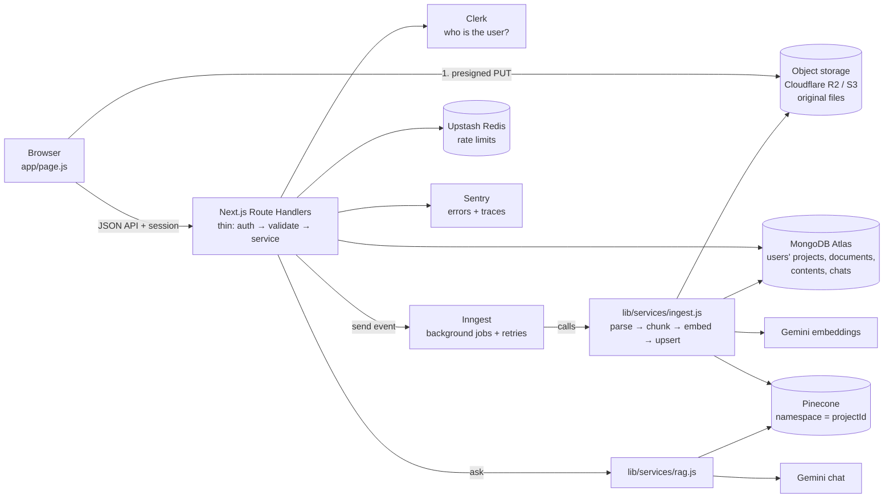
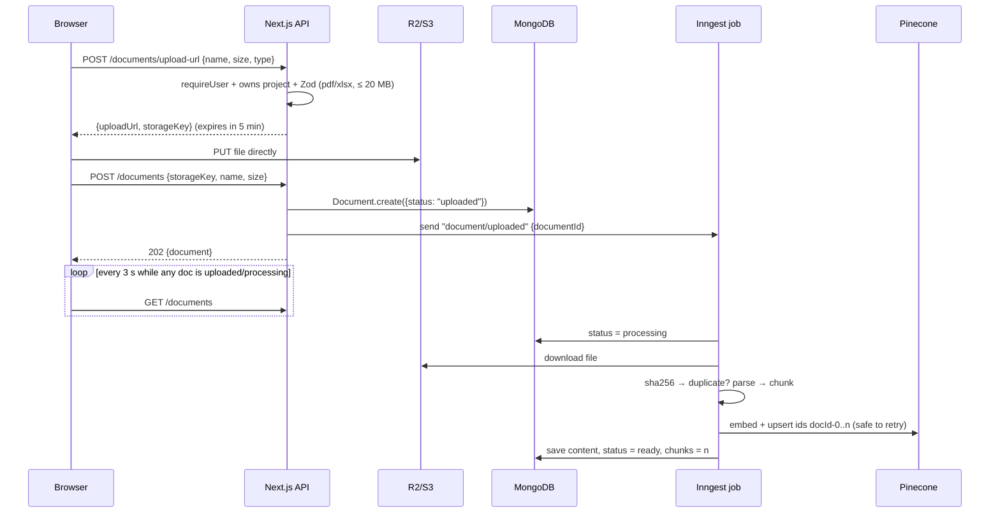

# Sourcework: Production Architecture Plan

Goal: **easy to maintain, simple code, scales well, production grade**, all inside the existing Next.js app.
This is a plan only. No existing code has been changed.

---

## 1. The target architecture in one picture



**Rule of the design:** every external system has **one job**:

| System | One job | Replaces today's |
|---|---|---|
| **MongoDB Atlas** (+ Mongoose) | Source of truth for projects, documents, status, parsed text, chats | `data/projects.json`, `data/documents/*.json` |
| **R2 or S3** | Original uploaded files | nothing (files are thrown away today) |
| **Pinecone** | Vectors only | same (kept, already working) |
| **Inngest** | Run ingestion in the background with retries | ingestion inside the upload request |
| **Clerk** | Login and user identity | nothing (no auth today) |
| **Upstash Redis** | Rate limiting | nothing |
| **Sentry** | Error tracking | `console.error` |

### Why these choices

- **MongoDB, not PostgreSQL:** you already know MERN, the data is document-shaped, and Mongoose gives you the schema you're missing today.
- **Keep Pinecone:** it already works, and migrating it gains nothing right now. *(Later you could store vectors in MongoDB Atlas Vector Search and drop Pinecone, leaving one fewer service. Only worth it once everything else is stable.)*
- **Inngest, not BullMQ:**
  - BullMQ needs Redis **plus a worker process that is always running**, which Vercel can't host.
  - Inngest runs **inside your Next.js app** as one route (`/api/inngest`) and gives you retries, concurrency limits and a dashboard.
  - *If you deploy with Docker on a VPS or Railway instead of Vercel, BullMQ is equally good. The service code stays the same; only the trigger changes.*
- **Direct-to-storage uploads (presigned URL):**
  - Vercel rejects request bodies over **4.5 MB**, so today's 10 MB uploads through the API would fail there.
  - Sending files straight from the browser to R2/S3 also keeps large files out of your server's memory.
- **Clerk:** the least auth code to write and maintain. *(Auth.js is the free, self-hosted alternative.)*

---

## 2. Folder structure (thin routes, fat services)

```
ai-agent-js/
├── app/
│   ├── page.js                         UI (later split into components/)
│   ├── layout.js                       + <ClerkProvider>
│   └── api/
│       ├── projects/route.js           GET, POST
│       ├── projects/[projectId]/route.js                 DELETE
│       ├── projects/[projectId]/documents/route.js       GET (status list), POST (register upload)
│       ├── projects/[projectId]/documents/upload-url/route.js   POST → presigned URL
│       ├── projects/[projectId]/documents/[documentId]/route.js DELETE
│       ├── projects/[projectId]/export/route.js          POST
│       ├── projects/[projectId]/chat/route.js            POST (replaces /api/rag)
│       └── inngest/route.js            Inngest endpoint
├── lib/
│   ├── db.js                           Mongo connection (cached)
│   ├── models/                         Mongoose schemas = YOUR DB SCHEMA
│   │   ├── Project.js
│   │   ├── Document.js
│   │   └── Conversation.js
│   ├── services/                       Business logic, no HTTP in here
│   │   ├── projects.js                 create/list/delete + ownership check
│   │   ├── documents.js                register, list, delete
│   │   ├── ingest.js                   parse → chunk → embed → upsert (moved from route)
│   │   ├── rag.js                      retrieve + prompt + answer (moved from route)
│   │   └── export.js                   = today's exportData.js
│   ├── ai/                             today's geminiEmbeddings.js, geminiInteractions.js, vectorStore.js
│   ├── parsing/documentContent.js      today's parseDocument
│   ├── storage.js                      R2/S3 presign, get, delete
│   ├── jobs.js                         Inngest client + functions
│   ├── auth.js                         requireUser()
│   ├── validation.js                   Zod schemas
│   └── http.js                         one error → Response helper
└── scripts/migrate-json-to-mongo.mjs   one-off migration
```

**Every route handler follows the same 4 lines:** check the user → validate the input → call one service → return the result. All logic lives in `lib/services/`, which can be called from routes, jobs and tests.

---

## 3. The database schema (MongoDB)

```mermaid
erDiagram
    USER ||--o{ PROJECT : owns
    PROJECT ||--o{ DOCUMENT : contains
    DOCUMENT ||--|| DOCUMENT_CONTENT : "parsed text"
    PROJECT ||--o{ CONVERSATION : has
    PROJECT ||--|| PINECONE_NAMESPACE : "namespace = project._id"
    DOCUMENT ||--o{ VECTOR : "ids = docId-0..chunks-1"

    USER { string clerkUserId "lives in Clerk, not Mongo" }
    PROJECT { ObjectId _id PK
              string ownerId "Clerk user id, indexed"
              string name
              date createdAt }
    DOCUMENT { ObjectId _id PK
               ObjectId projectId FK
               string ownerId
               string name
               string format "pdf|xlsx"
               number size
               string storageKey "R2/S3 key"
               string sha256 "dedupe"
               string status "uploaded|processing|ready|failed"
               string error
               number sections
               number chunks
               date createdAt }
    DOCUMENT_CONTENT { ObjectId documentId PK_FK
                       array sections "location, text" }
    CONVERSATION { ObjectId _id PK
                   ObjectId projectId FK
                   string ownerId
                   array messages "role, text, sources, at" }
```

### Changes from today, and why

| Change | Why |
|---|---|
| Documents get **their own collection** instead of being nested in the project | Listing projects stays fast; each document can be updated (`status`) without rewriting the whole project |
| **`ownerId`** on projects, documents and conversations | Every query becomes `find({ ownerId, … })`, so users can only see their own data |
| **`status`** field | Background processing needs "processing / ready / failed" for the UI |
| **`storageKey`** | The original file is kept, so you can re-process it (new model, new chunk size) without re-uploading |
| **`sha256`** + unique index `{projectId, sha256}` | Blocks duplicate uploads |
| **No `ids[]` array** | Vector IDs are always `${documentId}-${i}` for `i < chunks`, so they can be **calculated**, not stored |
| **No document text in MongoDB** | Chunk text lives in Pinecone (and the original file in storage). MongoDB holds only relations and metadata; export fetches chunks from Pinecone by their calculated ids |
| `Conversation` | Saves chat history (needed for follow-up questions and for users reloading the page) |

### Mongoose models (copy-ready)

```js
// lib/db.js
import mongoose from "mongoose";
let cached = global._mongoose ??= { conn: null, promise: null };
export async function connectDB() {
  if (cached.conn) return cached.conn;
  cached.promise ??= mongoose.connect(process.env.MONGODB_URI, { bufferCommands: false });
  cached.conn = await cached.promise;
  return cached.conn;
}
```
*Why cached on `global`:* in development Next.js reloads modules, and serverless reuses warm instances. Without the cache, every request would open a new connection.

```js
// lib/models/Project.js
import { Schema, model, models } from "mongoose";
const ProjectSchema = new Schema({
  ownerId: { type: String, required: true, index: true },
  name: { type: String, required: true, trim: true, maxlength: 80 },
}, { timestamps: true });
export default models.Project || model("Project", ProjectSchema);
```

```js
// lib/models/Document.js
import { Schema, model, models } from "mongoose";
const DocumentSchema = new Schema({
  projectId: { type: Schema.Types.ObjectId, ref: "Project", required: true },
  ownerId: { type: String, required: true },
  name: { type: String, required: true },
  format: { type: String, enum: ["pdf", "xlsx"], required: true },
  size: { type: Number, required: true },
  storageKey: { type: String, required: true },
  sha256: String,
  status: { type: String, enum: ["uploaded", "processing", "ready", "failed"], default: "uploaded" },
  error: String,
  chunks: { type: Number, default: 0 },
}, { timestamps: true });
DocumentSchema.index({ projectId: 1, createdAt: -1 });
DocumentSchema.index({ projectId: 1, sha256: 1 }, { unique: true, partialFilterExpression: { sha256: { $type: "string" } } });
export default models.Document || model("Document", DocumentSchema);
```

---

## 4. The new flows

### 4.1 Upload (fast response, work in the background)



Two details make this robust:
- **Deterministic IDs make retries safe.** Re-running the job upserts the same IDs, so there are never duplicates.
- **Failure is visible.** After the last retry the job sets `status: "failed"` and `error`, and the UI shows a "Retry" button that just sends the event again.

### 4.2 Ask
`POST /api/projects/:id/chat {conversationId?, question}`
1. `requireUser()` → load the project with `{ _id, ownerId }` → 404 if it isn't theirs.
2. Rate limit: for example 20 questions per minute per user.
3. Load the last 4 messages of the conversation.
4. **Retrieve:** similarity search, top 8, **drop matches below a minimum score**, keep only `ready` documents, return the best 5.
5. **Prompt:** instructions + short history + numbered excerpts + question. *(Optional later: rewrite follow-ups like "and for part-timers?" into a standalone question before searching.)*
6. Call Gemini with a **timeout**, save both messages to the conversation, return `{answer, sources, conversationId}`.

### 4.3 Delete a document
`status → "deleting"` → delete vectors (IDs calculated from `chunks`) → delete the file from storage → delete `Document`. Run it as an Inngest job too, so a failure halfway gets retried instead of leaving orphans.

---

## 5. Step-by-step migration (each phase ships on its own)

Do these **in order**. After each phase the app works and can be deployed.

### Phase 0: Refactor only (no behaviour change), about ½ day
1. Create `lib/services/ingest.js`. Move the body of the upload route (parse → split → `addDocuments` → save) into `ingestDocument({ projectId, documentId, file })`.
2. Create `lib/services/rag.js`. Move the body of `/api/rag` into `answerQuestion({ project, question })`.
3. Routes now just call these functions.

**Why first:** every later phase changes only *who calls* these services, not the RAG logic. Run `node --test` to confirm nothing broke.

### Phase 1: MongoDB replaces the JSON files, about 1 day
1. Create a free MongoDB Atlas cluster and add `MONGODB_URI` to `.env`.
2. `npm i mongoose`, then add `lib/db.js` and the models above.
3. Rewrite `lib/projects.js` functions with Mongoose, keeping the **same function names** so the routes barely change.
4. `scripts/migrate-json-to-mongo.mjs`: read `data/projects.json` and `data/documents/*.json` and insert them, keeping the old UUIDs in a `legacyId` field so the existing Pinecone namespace and vector IDs still match.
5. Delete the `pending` promise queue: MongoDB handles concurrent writes itself.

### Phase 2: Authentication, about ½ day
1. `npm i @clerk/nextjs`, add the Clerk keys, wrap `layout.js` in `<ClerkProvider>`, and add `middleware.js` with `clerkMiddleware()`.
2. `lib/auth.js`:
   ```js
   import { auth } from "@clerk/nextjs/server";
   export async function requireUser() {
     const { userId } = await auth();   // await works whether your Clerk version's auth() is sync or async
     if (!userId) throw new HttpError(401, "Sign in first.");
     return userId;
   }
   ```
3. Every service query adds `ownerId: userId`. Loading a project becomes `Project.findOne({ _id, ownerId })`, which is the **authorization check**.

### Phase 3: File storage, about ½ day
1. Create an R2 bucket (S3-compatible, no egress fees). Run `npm i @aws-sdk/client-s3 @aws-sdk/s3-request-presigner`.
2. `lib/storage.js`: `presignUpload(key, type)`, `getFile(key)`, `deleteFile(key)`.
3. Key format: `projects/{projectId}/{documentId}/{safeFileName}`.
4. Frontend: get the URL → `fetch(uploadUrl, { method: "PUT", body: file })` → register the document.

### Phase 4: Background ingestion, about 1 day
1. `npm i inngest`, then add `lib/jobs.js` and `app/api/inngest/route.js`:
   ```js
   // lib/jobs.js
   import { Inngest } from "inngest";
   import { ingestDocument } from "./services/ingest";
   export const inngest = new Inngest({ id: "sourcework" });
   export const ingestJob = inngest.createFunction(
     { id: "ingest-document", retries: 3, concurrency: { limit: 2 } },   // 2 at a time = respects the Gemini rate limit
     { event: "document/uploaded" },
     async ({ event, step }) => step.run("ingest", () => ingestDocument(event.data.documentId)),
   );
   ```
   ```js
   // app/api/inngest/route.js
   import { serve } from "inngest/next";
   import { inngest, ingestJob } from "@/lib/jobs";
   export const { GET, POST, PUT } = serve({ client: inngest, functions: [ingestJob] });
   ```
2. `ingestDocument(documentId)` now loads the file from storage instead of receiving it from the request, and sets `status`.
3. Upload route: create the document, `await inngest.send({ name: "document/uploaded", data: { documentId } })`, return **202**.
4. UI: show a status badge and poll while anything is `uploaded` or `processing`.
5. Dev: `npx inngest-cli dev` gives you a local dashboard showing every job, retry and error.

*Large documents:* if one job could exceed your host's time limit, split it into steps (`step.run("parse")`, then one `step.run("embed-batch-N")` per 50 chunks). Inngest saves progress between steps.

### Phase 5: Better answers, about 1 day
1. Embedding `taskType`: `RETRIEVAL_DOCUMENT` when indexing, `RETRIEVAL_QUERY` when searching. **This needs a re-index**, which is now easy because the original files are stored.
2. A minimum similarity score (start around 0.5 and tune it on real questions).
3. The `Conversation` model + the last 4 messages in the prompt.
4. Optional: streaming answers.

### Phase 6: Production hardening, about 1 day
| Item | How |
|---|---|
| Input validation | Zod schema per route in `lib/validation.js` |
| One error format | `HttpError` class + `handle(fn)` wrapper in `lib/http.js` → `{error}` with the right status code; never return raw upstream errors |
| Rate limits | `@upstash/ratelimit` on chat, upload-url, export |
| Timeouts | `AbortSignal.timeout(30_000)` on Gemini `fetch` calls |
| API key | Send `x-goog-api-key` as a header, not in the URL |
| Errors and traces | `@sentry/nextjs` |
| Tests | Keep `node:test` for services; add one end-to-end test per flow |
| CI | GitHub Actions: lint, test, `next build` |
| Cleanup | A weekly Inngest cron that finds vectors or files without a `Document` row and deletes them (this also catches the 500 orphans in today's default namespace) |

---

## 6. Environment variables (final)

```
MONGODB_URI=
GOOGLE_API_KEY=
PINECONE_API_KEY=
PINECONE_INDEX=
NEXT_PUBLIC_CLERK_PUBLISHABLE_KEY=
CLERK_SECRET_KEY=
R2_ACCOUNT_ID=
R2_ACCESS_KEY_ID=
R2_SECRET_ACCESS_KEY=
R2_BUCKET=
INNGEST_EVENT_KEY=        # production only
INNGEST_SIGNING_KEY=      # production only
UPSTASH_REDIS_REST_URL=
UPSTASH_REDIS_REST_TOKEN=
SENTRY_DSN=
```
Remove the unused `TAVILY_API_KEY`, `TOGETHER_AI_API_KEY` and `PINECONE_DATABASE`.

---

## 7. How this scales

| Load | What handles it |
|---|---|
| Many users | Stateless Next.js routes scale out; MongoDB handles concurrent writes; Clerk handles sessions |
| Big uploads | Browser → R2 directly, so the server never holds the file during upload |
| Many uploads at once | Inngest queues them; `concurrency: 2` keeps you under the Gemini rate limit, and the rest wait instead of failing |
| Failed AI calls | Job retries with backoff; status shows the user what happened |
| Many questions | Rate limit per user; small prompts; optional Redis cache for repeated questions |
| Lots of data | Pinecone serverless + MongoDB indexes on `projectId` and `ownerId` |

## 8. What I'd deliberately **not** add yet
- **LangGraph or agents:** a single retrieve → answer step is enough for this product.
- **Microservices:** one Next.js app + services folder is easier to maintain.
- **A reranker model:** try the score threshold first, and measure before adding cost.
- **Moving vectors into MongoDB:** only if you later want one fewer service.
