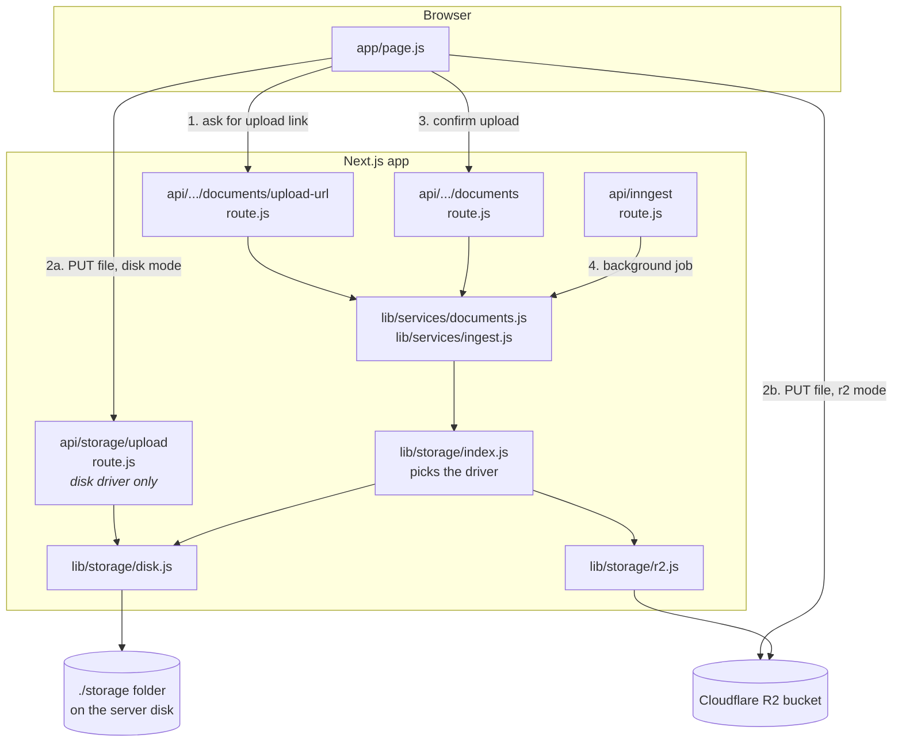
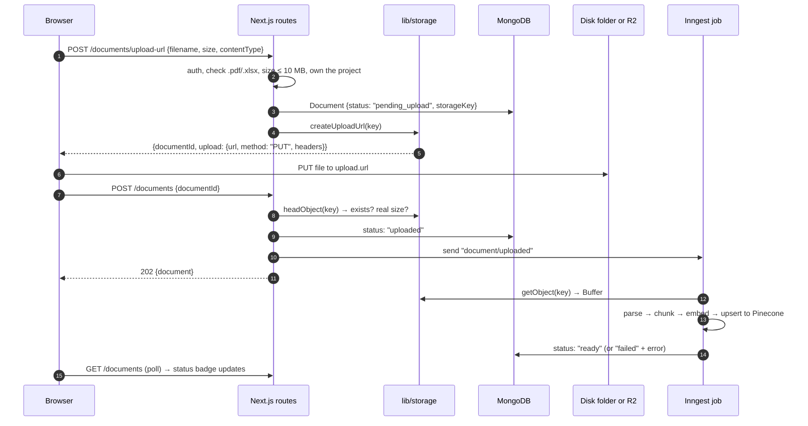
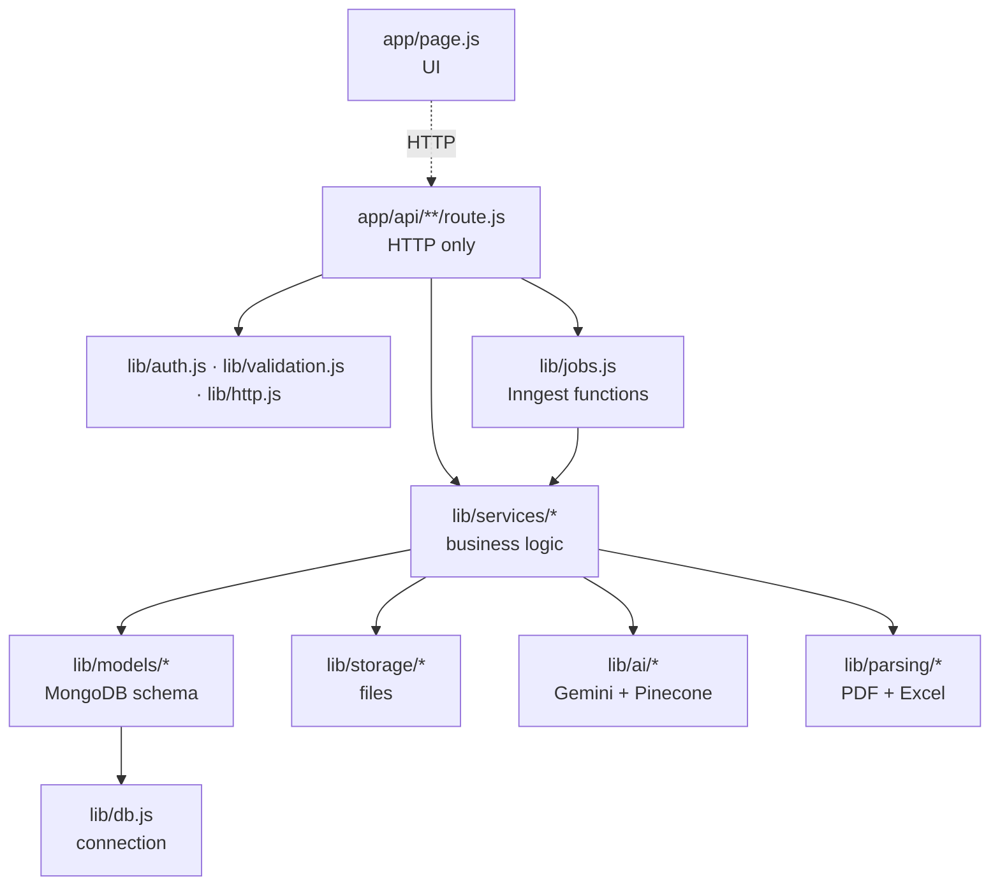

# Sourcework: File Storage Plan (disk now, R2 later) + Folder Structure

This is a plan only. No app code has been changed. It expands **Phase 3** of [PRODUCTION_PLAN.md](PRODUCTION_PLAN.md).

**The idea in one line:** the app talks to **one storage module** with 5 functions. Behind it there are two drivers:

| Driver | Where files live | Use it for |
|---|---|---|
| `disk` | A folder on the server (`./storage`) | Local development, or one VPS/Docker server with a persistent volume |
| `r2` | A Cloudflare R2 bucket | Vercel/serverless, more than one server, or when you don't want to back up a disk |

You switch with one env var, `STORAGE_DRIVER=disk` or `STORAGE_DRIVER=r2`. No service, route or UI code changes.

---

## 1. The big picture



The browser always does the **same 3 steps**. The only difference is where step 2 sends the file:
- **disk:** to your own route `/api/storage/upload`, protected by a signed, expiring link.
- **r2:** straight to R2, using a presigned URL. The file never touches your server.

---

## 2. The upload flow, step by step



**Why the confirm step (step 7) checks the file again:** a presigned R2 link can't limit the file size, and a user could skip the upload or send a different file. So the server never trusts the browser: it asks storage for the real size and refuses anything over 10 MB.

**Document status** gains one value compared with the production plan:
`pending_upload → uploaded → processing → ready | failed`.
Documents stuck in `pending_upload` for more than a day were abandoned (tab closed mid-upload). The weekly cleanup job from Phase 6 deletes them and their files.

**Storage keys** are always built by the server, never taken from the browser:

```
{userId}/{projectId}/{documentId}.{pdf|xlsx}
e.g.  user_2abc/6650f1.../6650f2....pdf
```

Grouping by user and project means deleting a project is one "delete everything under this prefix" call.

---

## 3. Folder structure (final)

```
ai-agent-js/
├── app/
│   ├── layout.js
│   ├── page.js
│   └── api/
│       ├── projects/
│       │   ├── route.js
│       │   └── [projectId]/
│       │       ├── route.js
│       │       ├── chat/route.js
│       │       ├── export/route.js
│       │       └── documents/
│       │           ├── route.js
│       │           ├── upload-url/route.js
│       │           └── [documentId]/route.js
│       ├── storage/
│       │   └── upload/route.js          ← disk driver only
│       └── inngest/route.js
├── lib/
│   ├── db.js
│   ├── auth.js
│   ├── http.js
│   ├── validation.js
│   ├── jobs.js
│   ├── models/
│   │   ├── Project.js
│   │   ├── Document.js
│   │   ├── DocumentContent.js
│   │   └── Conversation.js
│   ├── services/
│   │   ├── projects.js
│   │   ├── documents.js
│   │   ├── ingest.js
│   │   ├── rag.js
│   │   └── export.js
│   ├── storage/                         ← NEW
│   │   ├── index.js
│   │   ├── disk.js
│   │   └── r2.js
│   ├── ai/
│   │   ├── embeddings.js
│   │   ├── chat.js
│   │   └── vectorStore.js
│   └── parsing/
│       └── documentContent.js
├── storage/                             ← uploaded files in disk mode (git-ignored)
├── scripts/
│   └── migrate-json-to-mongo.mjs
├── tests/
└── .env
```

### How the folders depend on each other

Arrows mean "imports". They only point downwards; nothing below ever imports something above it.



---

## 4. File-by-file explanation

### `app/`: the UI and the HTTP door

| File | What it does | Calls |
|---|---|---|
| `layout.js` | Root HTML shell. Wraps the app in `<ClerkProvider>` so every page knows the user. | Clerk |
| `page.js` | The whole UI. Upload becomes 3 calls (get link → PUT file → confirm) and polls the document list until each status is `ready` or `failed`. | The API routes |

### `app/api/`: route handlers (thin: auth → validate → service → reply)

| File | Methods | What it does | Service it calls |
|---|---|---|---|
| `projects/route.js` | GET, POST | List the user's projects; create one | `projects.listProjects`, `projects.createProject` |
| `projects/[projectId]/route.js` | DELETE | Delete a project with its documents, vectors and files | `projects.deleteProject` |
| `.../documents/route.js` | GET, POST | GET: documents with status (the UI polls this). POST `{documentId}`: confirm an upload finished and start ingestion | `documents.listDocuments`, `documents.confirmUpload` |
| `.../documents/upload-url/route.js` | POST | Takes `{filename, size, contentType}`, creates the `pending_upload` document, returns the upload link | `documents.createUpload` |
| `.../documents/[documentId]/route.js` | DELETE | Delete one document everywhere | `documents.deleteDocument` |
| `.../export/route.js` | POST | Extract fields → Excel or PDF download | `export.exportFields` |
| `.../chat/route.js` | POST | Ask a question about the project (replaces `/api/rag`) | `rag.answerQuestion` |
| `storage/upload/route.js` | PUT | **Disk driver only.** Checks the signed link, streams the body into `./storage` with a 10 MB cap. Returns 404 when `STORAGE_DRIVER=r2`. | `storage/disk.js` directly |
| `inngest/route.js` | GET, POST, PUT | The door Inngest uses to run your background jobs | `jobs.js` |

### `lib/` root: shared helpers

| File | What it does |
|---|---|
| `db.js` | `connectDB()`: one MongoDB connection, cached on `global` so serverless functions and hot reload reuse it. |
| `auth.js` | `requireUser()`: returns the Clerk `userId` or throws 401. |
| `http.js` | `HttpError(status, message)` and `toResponse(err)`: turns any thrown error into a JSON response; unknown errors become 500 and go to Sentry. |
| `validation.js` | Zod schemas for every request body (project name, question, upload request, export request). |
| `jobs.js` | The Inngest client and `ingestJob` (`retries: 3`, `concurrency: 2`), which just calls `ingest.ingestDocument(documentId)`. |

### `lib/models/`: the database schema

| File | Collection | Key fields |
|---|---|---|
| `Project.js` | `projects` | `ownerId`, `name`, `createdAt` |
| `Document.js` | `documents` | `projectId`, `ownerId`, `name`, `format`, `size`, **`storageKey`**, `status`, `error`, `sha256`, `sections`, `chunks` |
| `DocumentContent.js` | `documentcontents` | `documentId`, `sections: [{location, text}]` (the parsed text, kept apart because it is large) |
| `Conversation.js` | `conversations` | `projectId`, `ownerId`, `messages: [{role, content, sources}]` |

### `lib/services/`: the business logic (no HTTP, no `req`/`Response`)

| File | Functions | What they do |
|---|---|---|
| `projects.js` | `listProjects`, `createProject`, `getOwnedProject`, `deleteProject` | Every query filters by `ownerId`. `deleteProject` runs: Pinecone `deleteAll` on the namespace → `storage.deletePrefix(userId/projectId)` → Mongo documents, contents and conversations → the project. |
| `documents.js` | `createUpload`, `confirmUpload`, `listDocuments`, `deleteDocument` | The upload handshake from section 2. `deleteDocument`: vectors → stored file → content → document row. |
| `ingest.js` | `ingestDocument(documentId)` | Loads the file with `storage.getObject`, computes `sha256` (duplicate check), parses, chunks, embeds, upserts with IDs `docId-0…n`, saves the content, sets `ready`. On error it sets `failed` with a readable message. |
| `rag.js` | `answerQuestion` | Today's `/api/rag` logic, plus saving to `Conversation`. |
| `export.js` | `exportFields` | Today's `lib/exportData.js`, moved. |

### `lib/storage/`: the new storage module

| File | What it does |
|---|---|
| `index.js` | Reads `STORAGE_DRIVER` and re-exports that driver's functions, plus `objectKey()`. **The rest of the app imports only this file.** |
| `disk.js` | Stores files under `STORAGE_DIR`. Creates HMAC-signed upload links, verifies them, writes uploads atomically (temporary file, then rename), and blocks path tricks like `../`. |
| `r2.js` | The same functions using the S3 API that R2 speaks (`@aws-sdk/client-s3`). Upload links are real presigned URLs. |

Both drivers export the same 5 functions:

| Function | Returns | Used by |
|---|---|---|
| `createUploadUrl({key, contentType, maxBytes})` | `{url, method, headers}` | `documents.createUpload` |
| `headObject(key)` | `{size}` or `null` | `documents.confirmUpload` |
| `getObject(key)` | `Buffer` | `ingest.ingestDocument` |
| `deleteObject(key)` | nothing | `documents.deleteDocument` |
| `deletePrefix(prefix)` | nothing | `projects.deleteProject` |

### `lib/ai/` and `lib/parsing/`: today's code, moved

| File | Today's file |
|---|---|
| `ai/embeddings.js` | `lib/geminiEmbeddings.js` |
| `ai/chat.js` | `lib/geminiInteractions.js` |
| `ai/vectorStore.js` | `lib/vectorStore.js` |
| `parsing/documentContent.js` | `parseDocument` and `documentFormat` from `lib/documentContent.js` (the save/load functions move into the `DocumentContent` model) |

### Other folders

| Path | What it is |
|---|---|
| `storage/` | Uploaded files when `STORAGE_DRIVER=disk`. **Add `/storage/` to `.gitignore`.** Back it up like a database. |
| `scripts/migrate-json-to-mongo.mjs` | One-off: copies `data/projects.json` and `data/documents/*.json` into MongoDB. Old documents get no `storageKey` because the originals were never kept. |
| `tests/` | Service tests call service functions directly, with `STORAGE_DRIVER=disk` and a temporary `STORAGE_DIR`. No cloud account is needed to run them. |

---

## 5. The code (copy-ready, not yet run)

### `lib/storage/index.js`

```js
import * as disk from "./disk.js";
import * as r2 from "./r2.js";

const driver = process.env.STORAGE_DRIVER === "r2" ? r2 : disk;

export const { createUploadUrl, headObject, getObject, deleteObject, deletePrefix } = driver;

// Keys are always built here, on the server: never accept one from the browser.
export const objectKey = (userId, projectId, documentId, format) =>
  `${userId}/${projectId}/${documentId}.${format}`;
```

### `lib/storage/disk.js`

```js
import fs from "node:fs/promises";
import { createWriteStream } from "node:fs";
import path from "node:path";
import crypto from "node:crypto";
import { Readable, Transform } from "node:stream";
import { pipeline } from "node:stream/promises";

const ROOT = path.resolve(process.env.STORAGE_DIR || "storage");
const SAFE = /^[\w-]+(\/[\w-]+)*(\.(pdf|xlsx))?$/;   // letters, digits, _ and - only: no "..", no "\"

function safePath(rel) {
  const full = path.resolve(ROOT, rel);
  if (!SAFE.test(rel) || !full.startsWith(ROOT + path.sep)) throw new Error("Invalid storage key.");
  return full;
}

function sign(key, expires, maxBytes) {
  const secret = process.env.STORAGE_SIGNING_SECRET;
  if (!secret) throw new Error("STORAGE_SIGNING_SECRET is not set.");
  return crypto.createHmac("sha256", secret).update(`${key}|${expires}|${maxBytes}`).digest("hex");
}

export async function createUploadUrl({ key, contentType, maxBytes }) {
  safePath(key);
  const expires = Date.now() + 10 * 60_000;            // link works for 10 minutes
  const sig = sign(key, expires, maxBytes);
  const query = new URLSearchParams({ key, expires, maxBytes, sig });
  return { url: `/api/storage/upload?${query}`, method: "PUT", headers: { "Content-Type": contentType } };
}

export function verifyUpload({ key, expires, maxBytes, sig }) {
  if (!key || !(Date.now() < Number(expires))) return false;
  const expected = Buffer.from(sign(key, expires, maxBytes), "hex");
  const given = Buffer.from(sig || "", "hex");
  return given.length === expected.length && crypto.timingSafeEqual(given, expected);
}

export async function saveStream(key, webStream, maxBytes) {
  const target = safePath(key);
  await fs.mkdir(path.dirname(target), { recursive: true });
  const tmp = `${target}.${crypto.randomUUID()}.part`;
  let size = 0;
  const limit = new Transform({
    transform(chunk, _enc, done) {
      size += chunk.length;
      done(size > maxBytes ? new Error("File too large.") : null, chunk);
    },
  });
  try {
    await pipeline(Readable.fromWeb(webStream), limit, createWriteStream(tmp));
    await fs.rename(tmp, target);                     // readers never see half a file
  } catch (error) {
    await fs.rm(tmp, { force: true });
    throw error;
  }
  return size;
}

export const getObject = (key) => fs.readFile(safePath(key));

export async function headObject(key) {
  try { return { size: (await fs.stat(safePath(key))).size }; }
  catch (error) { if (error.code === "ENOENT") return null; throw error; }
}

export const deleteObject = (key) => fs.rm(safePath(key), { force: true });
export const deletePrefix = (prefix) => fs.rm(safePath(prefix), { recursive: true, force: true });
```

### `lib/storage/r2.js`

Needs `npm i @aws-sdk/client-s3 @aws-sdk/s3-request-presigner`.

```js
import {
  S3Client, PutObjectCommand, GetObjectCommand, HeadObjectCommand,
  DeleteObjectCommand, ListObjectsV2Command, DeleteObjectsCommand,
} from "@aws-sdk/client-s3";
import { getSignedUrl } from "@aws-sdk/s3-request-presigner";

const s3 = new S3Client({
  region: "auto",
  endpoint: `https://${process.env.R2_ACCOUNT_ID}.r2.cloudflarestorage.com`,
  credentials: {
    accessKeyId: process.env.R2_ACCESS_KEY_ID,
    secretAccessKey: process.env.R2_SECRET_ACCESS_KEY,
  },
});
const Bucket = process.env.R2_BUCKET;

// maxBytes can't be enforced by a presigned PUT; confirmUpload checks the real size instead.
export async function createUploadUrl({ key, contentType }) {
  const command = new PutObjectCommand({ Bucket, Key: key, ContentType: contentType });
  const url = await getSignedUrl(s3, command, { expiresIn: 600 });
  return { url, method: "PUT", headers: { "Content-Type": contentType } };
}

export async function getObject(key) {
  const res = await s3.send(new GetObjectCommand({ Bucket, Key: key }));
  return Buffer.from(await res.Body.transformToByteArray());
}

export async function headObject(key) {
  try {
    const res = await s3.send(new HeadObjectCommand({ Bucket, Key: key }));
    return { size: res.ContentLength };
  } catch (error) {
    if (error.$metadata?.httpStatusCode === 404) return null;
    throw error;
  }
}

export const deleteObject = (key) => s3.send(new DeleteObjectCommand({ Bucket, Key: key }));

export async function deletePrefix(prefix) {
  let ContinuationToken;
  do {
    const page = await s3.send(new ListObjectsV2Command({ Bucket, Prefix: `${prefix}/`, ContinuationToken }));
    if (page.Contents?.length) {
      await s3.send(new DeleteObjectsCommand({
        Bucket, Delete: { Objects: page.Contents.map(({ Key }) => ({ Key })) },
      }));
    }
    ContinuationToken = page.NextContinuationToken;
  } while (ContinuationToken);
}
```

### `app/api/storage/upload/route.js` (disk driver only)

```js
import { verifyUpload, saveStream } from "@/lib/storage/disk";

export const runtime = "nodejs";

export async function PUT(req) {
  if (process.env.STORAGE_DRIVER === "r2") return new Response("Not found", { status: 404 });

  // The signed link is the permission: only the owner was given it, by createUpload.
  const query = Object.fromEntries(new URL(req.url).searchParams);
  if (!verifyUpload(query)) {
    return Response.json({ error: "This upload link is invalid or has expired." }, { status: 403 });
  }
  try {
    const size = await saveStream(query.key, req.body, Number(query.maxBytes));
    return Response.json({ size });
  } catch (error) {
    const tooLarge = error.message === "File too large.";
    return Response.json({ error: error.message }, { status: tooLarge ? 413 : 400 });
  }
}
```

### `lib/services/documents.js` (the storage parts)

```js
import { connectDB } from "@/lib/db";
import { Document } from "@/lib/models/Document";
import { getOwnedProject } from "./projects";
import { createUploadUrl, headObject, deleteObject, objectKey } from "@/lib/storage";
import { documentFormat } from "@/lib/parsing/documentContent";
import { inngest } from "@/lib/jobs";
import { HttpError } from "@/lib/http";

const MAX_BYTES = 10 * 1024 * 1024;

export async function createUpload(userId, projectId, { filename, size, contentType }) {
  await connectDB();
  await getOwnedProject(userId, projectId);                  // throws 404 if not yours
  const format = documentFormat(filename);
  if (!format) throw new HttpError(400, "Choose a PDF or Excel (.xlsx) file.");
  if (size > MAX_BYTES) throw new HttpError(413, "Files must be 10 MB or smaller.");

  const doc = new Document({ projectId, ownerId: userId, name: filename, format, size, status: "pending_upload" });
  doc.storageKey = objectKey(userId, projectId, doc.id, format);
  await doc.save();

  const upload = await createUploadUrl({ key: doc.storageKey, contentType, maxBytes: MAX_BYTES });
  return { documentId: doc.id, upload };
}

export async function confirmUpload(userId, projectId, documentId) {
  await connectDB();
  const doc = await Document.findOne({ _id: documentId, projectId, ownerId: userId, status: "pending_upload" });
  if (!doc) throw new HttpError(404, "Upload not found.");

  const stored = await headObject(doc.storageKey);           // never trust the browser's size
  if (!stored) throw new HttpError(400, "The file was not uploaded.");
  if (stored.size > MAX_BYTES) {
    await deleteObject(doc.storageKey);
    await doc.deleteOne();
    throw new HttpError(413, "Files must be 10 MB or smaller.");
  }

  doc.size = stored.size;
  doc.status = "uploaded";
  await doc.save();
  await inngest.send({ name: "document/uploaded", data: { documentId: doc.id } });
  return doc;
}
```

### `lib/services/ingest.js` (the storage part)

```js
const buffer = await getObject(doc.storageKey);
const sha256 = crypto.createHash("sha256").update(buffer).digest("hex");
const sections = await parseDocument(new File([buffer], doc.name));   // parseDocument takes a File today
```

`File` is global from Node 20. On Node 18, import it with `import { File } from "node:buffer"`.

### `app/page.js` (the upload function)

```js
async function uploadFile(projectId, file) {
  const base = `/api/projects/${projectId}/documents`;
  const start = await postJson(`${base}/upload-url`, {
    filename: file.name, size: file.size, contentType: file.type || "application/octet-stream",
  });

  const put = await fetch(start.upload.url, { method: start.upload.method, headers: start.upload.headers, body: file });
  if (!put.ok) throw new Error("Upload failed. Try again.");

  return postJson(base, { documentId: start.documentId });   // starts background ingestion
}
```

`postJson` is a small `fetch` helper that throws the API's `error` message. Write it once in `page.js`.

---

## 6. Environment variables

```bash
STORAGE_DRIVER=disk                 # disk | r2

# disk driver
STORAGE_DIR=./storage
STORAGE_SIGNING_SECRET=             # 32+ random characters: node -e "console.log(crypto.randomBytes(32).toString('hex'))"

# r2 driver
R2_ACCOUNT_ID=
R2_ACCESS_KEY_ID=
R2_SECRET_ACCESS_KEY=
R2_BUCKET=sourcework-uploads
```

---

## 7. Step-by-step build order

1. **Ignore the folder:** add `/storage/` to `.gitignore`.
2. **Disk driver:** add `lib/storage/index.js` and `disk.js`, then `app/api/storage/upload/route.js`. Set `STORAGE_DRIVER=disk` and `STORAGE_SIGNING_SECRET`.
3. **Model field:** add `storageKey`, `size` and the `pending_upload` status to `Document.js`.
4. **Services:** add `createUpload` and `confirmUpload`, and the `upload-url` route. Change `ingest.js` to read with `getObject`.
5. **UI:** switch `page.js` to the 3-step upload.
6. **Deletes:** `deleteDocument` calls `deleteObject`, and `deleteProject` calls `deletePrefix`.
7. **Test locally:** upload a PDF, check that `storage/<user>/<project>/<doc>.pdf` exists, ask a question, delete the document and check the file is gone. Also test an expired link (403) and an 11 MB file (413).
8. **Move to R2, when you deploy to Vercel or more than one server:**
   1. Create the bucket and an API token with read and write access to that bucket only.
   2. Add a CORS rule so the browser may `PUT`:
      ```json
      [{ "AllowedOrigins": ["http://localhost:3000", "https://your-domain.com"],
         "AllowedMethods": ["PUT"], "AllowedHeaders": ["Content-Type"], "MaxAgeSeconds": 3600 }]
      ```
   3. `npm i @aws-sdk/client-s3 @aws-sdk/s3-request-presigner`, add `r2.js`, set the R2 env vars and `STORAGE_DRIVER=r2`.
   4. Copy files you already stored on disk into the bucket with the same keys, for example `rclone copy ./storage r2:sourcework-uploads`.

---

## 8. Disk vs R2: rules to remember

| | disk | r2 |
|---|---|---|
| Works on Vercel | **No:** the filesystem is temporary and every function has its own | Yes |
| More than one server | Only with a shared volume | Yes |
| Uploads pass through your server | Yes (streamed, capped at 10 MB) | No |
| Backups | Your job (snapshot the volume) | Handled by Cloudflare |
| Cost | Free | Free up to 10 GB, no download fees |
| Ingest job must run | On the same machine as the files | Anywhere |

- **Never** build a storage key from browser input. Only `objectKey()` creates keys.
- **Never** make the bucket public. Files are read by the server (`getObject`) only.
- `index.js` imports both drivers, so the AWS packages must be installed even in disk mode once `r2.js` exists. If that bothers you, add `r2.js` only at step 8.
